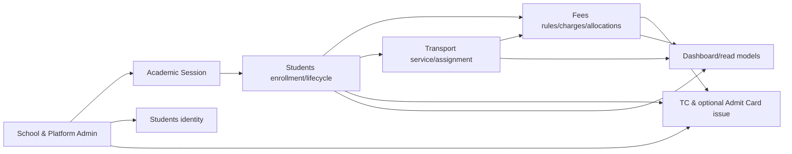

# Shared Implementation Contracts — DLD Appendix (Proposed)

**Purpose:** Concrete cross-task technical patterns so a junior engineer does not build 32 incompatible implementations. All declarations are **design proposals**: approved PRD/HLD/user stories/UIUX and official module DLD must adopt them through governed changes before implementation.

## 1. Module dependency graph (no circular ownership)



The graph above represents **consumer reads/decisions through ports**, not ownership or code imports. Auth/Audit/File/Jobs are Foundation. New Academic Session module owns school-year policy; Student module owns annual enrollments and exit; Fees owns financial ledger; Transport owns service; existing Platform TC owner exposes issuance facade for operator, never duplicate TC repository. Legacy direct SQL cross-boundary patterns must be removed incrementally (see architecture audit).

## 2. School year, enrollment and exit state machines

```text
School state: DRAFT --(activate after readiness)--> ACTIVE --(deactivate)--> INACTIVE
AcademicSession: DRAFT --(activate)--> ACTIVE --(close preview)--> CLOSING --> CLOSED
Student: ACTIVE/INACTIVE (identity scope) + ExitEvent reason/effectiveDate
StudentEnrollment: ACTIVE for selected session --> ENDED (promoted|repeat|left|passout|correction)
Document: QUEUED --> PROCESSING --> COMPLETED / FAILED --(retry)--> QUEUED
```

**Important:** Student status is not a proxy for enrollment year or TC; `PASSED_OUT`/LEFT is an exit outcome not identical to document issue. Closed year rejects routine writes while authorized fees collection against **old charges** is a new dated payment entry. A school year is not login `UserSession`.

### Proposed DB constraints

```sql
-- AcademicSession unique across school + code.
CREATE UNIQUE INDEX acad_session_code_unique ON academic_sessions (school_id, code);
CREATE UNIQUE INDEX acad_one_active_per_school ON academic_sessions(school_id) WHERE status = 'ACTIVE';

-- Active enrollment per student+year; legacy backfill and overlapping date rules require review.
CREATE UNIQUE INDEX enrollment_active_per_year ON student_enrollments (school_id, student_id, academic_session_id)
WHERE status = 'ACTIVE' AND academic_session_id IS NOT NULL;

-- One business origin per billed obligation, independent of number of categories in the same month.
CREATE UNIQUE INDEX fee_source_unique ON fee_charges (school_id, source_key);

-- One idempotent payment request key per school.
CREATE UNIQUE INDEX fee_payment_idempotency ON fee_payments (school_id, idempotency_key);

-- Unique sequence per school/type/series under configured policy.
CREATE UNIQUE INDEX number_series_unique ON number_sequences (school_id, entity_type, series_key);
```

These example identifiers and columns are additive target contracts, not SQL migrations to run without reconciled Prisma naming and legacy constraints.

## 3. Exact payment and TC issuance concurrency strategy

**Problem:** Locking only *existing fee charge rows* is insufficient if a new overdue charge can be inserted concurrently with a TC eligibility check. Use a **per-student fee account lock** that serializes *all ledger-affecting operations* and fee-clearance issuance decisions.

**Proposed account table:** `StudentFeeAccount(schoolId,studentId,ledgerRevision bigint NOT NULL DEFAULT 0,createdAt,updatedAt)` unique `(schoolId,studentId)` with validated same-school foreign reference. Fees module owns it; create lazily transactionally or on student admission via public facade.

**All Fees mutations must follow one lock order:**
1. Begin PostgreSQL transaction (bounded duration).
2. Fees public service `lockAccount(tx,schoolId,studentId)`: SELECT FeeAccount FOR UPDATE; ensure account creation is concurrent-safe.
3. Validate policy and retrieve scoped charge rows; if locking multiple, order charge IDs ascending.
4. Apply Assessment, Payment, Void, Concession Adjustment or Import, update balances and increment `ledgerRevision`.
5. Commit with audit outbox and immutable source IDs.

**TC issuance transaction:**
1. Begin transaction and ask **FeesPublicFacade** to lock same `StudentFeeAccount` through a transaction-bound public port, not by TC service accessing fee table.
2. Fees computes pending eligible charges and unassessed-period policy, returns `{eligible,total,ledgerRevision,policyVersion}` under the lock.
3. If not eligible, abort before TC/job enqueue. If eligible, validate snapshot/branding (minimize I/O during DB lock), insert TC+Job+AuditOutbox while lock held; commit.
4. All concurrent financial mutations wait on same account lock. No new charge or void can slip between check and issue.
5. Worker receives jobId and renders frozen authorized issue; never performs issuance eligibility itself.

**Implementation caveat:** This is an *in-process modular monolith*, so a safe transaction-bound `FeesPublicFacade.withLockedStudentAccount(tx, scope, callback)` may be approved. The callback must expose only allowed outcome operations, not FeeRepository. If module boundary allows no shared DB transaction, introduce an explicit reservation/state machine with equivalent exclusive coordination before approving the design. Do not implement fee-check GET followed by unprotected TC POST; that is racy.

### TypeScript port sketch (not yet approved API source)

```ts
interface FeesPublicFacade {
  getStudentStatement(input: {
    schoolId: string; studentId: string; asOfDate: string;
    academicSessionId?: string; includePriorSessions: boolean;
  }): Promise<FeeStatementDto>;

  checkDocumentClearanceInTransaction(input: {
    schoolId: string; studentId: string;
    purpose: 'TC' | 'ADMIT_CARD';
    asOfDate: string; policyVersion: string;
    transactionContext: ApprovedTransactionContext;
  }): Promise<{
    eligible: boolean;
    totalOutstandingMinorUnits: string;
    ledgerRevision: string;
    unassessedPeriods: string[];
    policyVersion: string;
    categoryBreakdown: Array<{
      code: string; period: string; balanceMinorUnits: string;
    }>;
  }>;

  postInitialCharges(input: {
    schoolId: string; studentId: string;
    admissionEventId: string; selectedCategories: string[];
    academicSessionId: string; idempotencyKey: string;
  }): Promise<{ chargeIds: string[] }>;

  stopFutureAccrual(input: {
    schoolId: string; studentId: string;
    effectiveDate: string; reason: string; idempotencyKey: string;
  }): Promise<{ applied: boolean }>;
}
```

Where Async API supports a shared transaction, `ApprovedTransactionContext` is an opaque context adapter, not a raw public `PrismaClient` exposing sibling data.

## 4. Financial invariants, allocations and specific SQL

```text
Charge.netAssessed = Charge.base + Charge.fine - Charge.discount + approvedAdjustments
Charge.paidAmount = SUM(active payment allocations to this charge)
Charge.balance   = Charge.netAssessed - Charge.paidAmount
School.totalOutstanding = SUM(charge.balance) over applicable school charges
One payment.amount = SUM(payment allocations) (exactly; voided payment allocations excluded from active sum)
```

- All money in PostgreSQL `numeric(12,2)` with exact Decimal representation; reject `NaN`, `Infinity`, negative payments, overpayment and precision beyond 2 decimals.
- Charge `sourceKey` is a deterministic business reference: `school/student/category/period/event/ruleVersionApplicability`. **Do not** use only current month, or several categories will collide.
- Repeated billed month generation must be idempotent, including after backfill. Arrival date is not charge eligibility date; use CL-02 effective policy.
- New receipt issued once for a `paymentId` and a `receiptNumber` from locked school+series sequence. A later void preserves issued number and snapshot.
- Arrears carry forward is a **statement aggregation**, never `INSERT` another fee equal to previous balance.
- Existing historical `FeeDue` and single-due `FeePayment` migrate to shadow `FeeCharge`/allocation mapping, then reconcile tenant-by-tenant before enabling new writer. Do not union both datasets into totals without dedupe mapping.

## 5. Number sequence and historic compatibility

**Separate policies:** STUDENT_ID vs RECEIPT; modes CONTINUOUS/ACADEMIC_YEAR/FINANCIAL_YEAR, configurable *only if approved*. `seriesKey` from school-selected AcademicSession or Asia/Kolkata financial-year start, but `School.id` and `Student.id` remain immutable UUIDs. Printed number includes enough prefix/context to avoid collisions after sequence reset, and old PDFs preserve frozen old number.

If resetting student-visible ID/SR conflicts with existing unique `school_id,normalizedCode`, do not relax uniqueness silently; choose unique prefixed display pattern or require explicit design signoff. Imports must support incoming legacy external IDs in separately named external-reference fields rather than overriding internal IDs.

## 6. Mid-year import correctness

```text
Uploaded workbook (private) -> parse/version check -> student matching and duplicate analysis
 -> normalized preview with charge category and source reference
 -> human signoff of exact opening balances (as-of date)
 -> idempotent FeeCharge(type OPENING_BALANCE) in bounded chunks
 -> tenant reconciliation -> finalized import receipt/report
```

Historical collected amounts must carry **source provenance** and cannot be silently treated as money newly collected in the SaaS. Control whether import includes old payments vs outstanding-only; never assume both. Protect against Excel formula injection in errors/exports.

## 7. Screens and user-friendly states

| Screen | Required states | Role boundary |
|---|---|---|
| School Sessions | No year, DRAFT form, ACTIVE badge, close preview, CLOSED history | MANAGER write, report-viewer restricted |
| Promote/Repeat/Leave | Student selection, review, exceptions, job progress, retry, history | MANAGER |
| Reactivate | Prior-year details, choose current year/class/section, fee preview, confirm | MANAGER |
| Fee Setup | Fee categories, rules/effective range, preview who affected | MANAGER |
| Student Fee Statement | Older-session arrears, older months, current month, per-charge/payments/total | MANAGER; report-viewer only approved read reports |
| Admission | Optional Aadhaar, books/uniform fee choice, preview total, admission status | MANAGER |
| TC / Admit Card | School branding readiness, dues gate, preview, queued/completed/failed, download | MANAGER; paid admit card CR blocked |
| Payment History | Search/filters, detail receipt, print Office/Student copies, PDF download, VOIDED state | Capabilities per approved report exposure |

Use server-derived permissions; all unexpected errors have human-friendly messages and focus-safe UI. Record exact UIUX screen inventory and wireframes in canonical Harness before implementation.

## 8. Required automated safety checks per PR

- Contract: every new handler declares permission and DTO/tenant scoping; default deny.
- DB: composite same-school FK, required uniqueness, active session invariant, fee balance CHECK, index explain plans.
- Deterministic tests: concurrency twice, idempotency retries, exact Decimal amounts, historical no-overwrite.
- End-to-end: 2026–27 -> year close -> 2027–28, leaving/rejoin and fee start/stop, old debt payment, TC clearance, PDF document source.
- NFR: existing PRD search/dashboard p95 plus new measured baselines; seeded 500/5k schools and document/backfill stress.
- Rollout: snapshot backup, expand/backfill/reconcile/cutover flags/contract, real rollback rehearsal, no production database reset.

**Never equate this proposed shared appendix with human-approved canonical DLD.**
