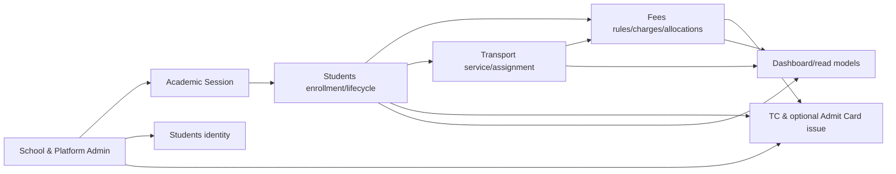

# Architecture and Detailed Technical Contracts — School ERP Incremental Delivery

**Decision status:** Proposed engineering design; requires reconciliation into **approved JASIQ Harness** PRD/HLD/stories/UIUX/DLD before coding. Every task must deliver a safe deployable slice on top of existing `main`. Task identities are **implementation deliverables**, not categorization by originating feedback.

## Engineering execution principles

1. **One owned aggregate per module:** School, Academics, Students, Fees, Transport, Documents. Cross-domain reads/commands via typed facade/ports and composed orchestration, never another module's Prisma model; review and safely eliminate existing exceptions when touched.
2. **No future dependencies:** A numbered task may only assume the features of lower-numbered tasks explicitly listed in the single tracker. Any additional integration reserved for a later task must be a backward-compatible extension point now, not unfinished code hidden behind 'TODO'.
3. **Migrations:** schema EXPAND -> compatibility adapter -> shadow backfill -> compare existing and new data -> controlled enablement -> verified rollback plan -> cleanup in separately approved change. Never rewrite existing production ledger in place.
4. **Time, identity and money:** AcademicSession != user auth session; Student immutable UUID != printed mutable ID; FeeCharge origin != payment receipt date; DATE in school calendar vs TIMESTAMPTZ UTC; numeric/Decimal only for financial authority.
5. **Authorization:** manager/viewer capability checks enforced by API/file/job as well as UI; school comes only from authenticated session, platform-admin remains separate security plane.
6. **Shared cross-domain lock:** all changes to a student's fee account, including assessments and voids, serialize against TC/admit issuance clearance, so no race between 'no pending fees' check and document queuing. Use approved transaction-bound fee facade, never SQL on another domain's private tables.
7. **Quality:** Every task individually includes FE/BE/NFR evidence and explicit regression. Only approved complete task can count DONE.

## Proposed architecture (read with the task briefs)


**Scope:** The original 26 tasks are **not sufficient** to cover all 10 research-PDF clarifications. This package adds CL-01..CL-06 and converts implicit business rules into explicit, separately approved decisions. This document is an **architecture proposal**, not a replacement for approved JASIQ Harness PRD/HLD/DLD. Implementation must await approved scope and canonical planning revision.

## 0. Existing approved contract and conflicts to resolve

Authoritative sources (read on 2026-10-16):
- `jasiqlabs/jasiq-harness/jasiq-specs/projects/custom-school-app/product/prd.md` **v2.0.0 APPROVED**.
- `architecture/hld.md` **v2.0.0 APPROVED**: NestJS modular monolith, Next.js 15 responsive web, Postgres 16/Prisma, Redis 7/BullMQ, private tenant files; use public ports/facades across modules.
- `design/dld/04-fee-management-dld.md` **v2.0.0 APPROVED**: monthly `FeeDue`, one-due-per-payment, snapshots, same-day void and nonretroactive generated charge snapshots.
- `custom-school-app/AGENTS.md`: approved Harness planning/user stories/UIUX/DLD are binding.

**Explicit conflicts:** PRD §2 lists **automatic academic-year rollover** and **exams** out of original MVP scope; PRD FR-STU-001 says **Aadhaar is required**; FR-ADMIN-007 makes TC issuance a **platform-admin capability**; FR-FEE-001..010 constrain MVP to monthly per-class dues. Client-requested optional Aadhaar, operator TC, multi-category fees, manual/assisted academic year transitions and Admit Card Generator change these contracts. PDF page 6 has NO marked client decisions. Thus **none** of these become approved simply because they appear in this specification. Harness revision and human approval is blocking.

**Important code-vs-approved-DLD inconsistency:** `generate-dues.service.ts` currently recalculates pending dues when concession changes, while approved DLD says already generated dues are immutable and new rules apply only to future not-yet-generated periods. FE-06/FE-07 must explicitly resolve this discrepancy via approved correction/adjustment model; do not silently back-edit historical debt.

## 1. Ownership map: one authority per business aggregate

| Owner | Owned state / data | Exposes via public port/facade | Must not do |
|---|---|---|---|
| Platform Admin / School | School profiles, codes, principal, operators, tenant enablement | SchoolInfoPublicFacade, SchoolReadiness status | Own student/fee balances |
| Academics (new school scoped) | AcademicSession lifecycle, validated current session, session closure | AcademicSessionPublicFacade, session eligibility | Directly mutate student/fees/transport internal tables |
| Students | Student identity, StudentEnrollment history, promotion/exit/rejoin state | StudentsPublicFacade (identity/enrollment/eligibility) | Read `fee_dues` or `fee_charges` via Prisma |
| Fees | FeeCategory, FeeRule, FeeCharge, FeePayment, allocations, opening balance entries, numbering/receipt snapshots | FeesPublicFacade: obligations, collect, clearance, summary | Change student identity/enrollment directly |
| Transport | Assigned route/stoppage/service dates | TransportPublicFacade: terminate future service from date | Mutate fees or student rows directly |
| Documents (TC within platform-admin existing owner unless approved module revision) | TC/document issue, frozen snapshots, jobs/file manifests; Admit Card separate paid CR | DocumentsPublicFacade: request/inspect/download | Bypass fee clearance or own fee logic |
| Dashboard | Composed read-only summary | Uses public facades | Reach into other domain tables or pretend own ledger |
| Foundation | Auth, audit, private storage, queue, idempotency primitives | Shared infrastructure | Absorb business session, finance policy |

**Migration of module ownership requires approval.** TC remains owned by platform-admin in existing HLD; operator controller should delegate into its published issuance facade, not create a second conflicting TC repository. For complex coupled exit/TC: implement an explicit **application workflow coordinator** using public commands and outbox/saga, while each owner updates only its domain. Never create circular constructor/DB dependencies.

## 2. Separation of identities / time axes

**Keep distinct:**
- `UserSession`: authentication/login, expires on inactivity.
- `AcademicSession`: school year (often 2026-27), school-owned ACTIVE/CLOSED.
- `Student`: stable person/tenant UUID and history across years, school active/inactive not interchangeable with annually enrolled.
- `StudentEnrollment`: time-bounded student/class/section placement with `academicSessionId`, start/end dates, reason, historical snapshots.
- `FeeCharge`: immutable assessed **obligation** tied to original session/period/type/due date.
- `FeePaymentAllocation`: amount applied to an existing charge (never creates an artificial carryforward bill).
- `TransportAssignment`: separately dated service that may cross an academic boundary according to policy.
- `TC / AdmitCard`: issued evidence frozen at issue time, not dynamic student data.

**Dates:** business `DATE` in Asia/Kolkata for school calendar; timestamps `timestamptz` stored UTC; session interval `[startDate,endDate]`, closing is explicit state (not auto on calendar expiry). A 2027-04-01 UI/SQL boundary may fall outside 2026-27; enforce date coverage or provide explicit approved exception. Do not default to calendar year.

## 3. Approved-code migration plan (expand → dual-read → backfill → verify → cutover → contract)

### Academic
Add `AcademicSession(schoolId,code,startDate,endDate,status,version,...)`, unique school/code; enforce at most one active session per school by partial SQL unique index. Add nullable `academicSessionId` to historical enrollments, plan per-school legacy assignment with review; keep an old query adapter until all IDs backfilled; **do not automatically assign all old enrollments to today's session**. Guarantee one active enrollment *per student in the active session*, and handle the older invariant of one ACTIVE enrollment globally on cutover. Use explicit overlap constraints for same student historical dates.

### Student leaving, return and corrections
School operational outcome should be explicit (`ENROLLED`, `LEFT`, `PASSED_OUT`, `INACTIVE_OTHER` or approved equivalent), separate from archived enrollment rows and TC issue record. Define leaving effective date and reason, end current enrollment and transport service through owned services, suppress **future** fee generation while preserving already assessed charges. TC generation does **not** automatically imply leaving unless client selects that behavior. Correction uses compensating audited workflow; no silent restored 'ACTIVE' enrollment from previous year. Re-admission creates a fresh session-specific enrollment linked to same student identity; recurring charge eligibility recalculated from new start date, one-time fees obey approved policy.

### Fees
Add `FeeCategory`, `FeeRule`, `FeeCharge`, `FeePaymentAllocation` and `FeeAdjustment` where validated; keep legacy `FeeDue`, `ClassFeeConfig`, `FeePayment.dueId` readable until reconciled. **Never** delete or rewrite paid financial history. Financial invariant for each charge: `netAssessed = sum(activeAllocated) + outstanding`, after authorized adjustments, not mutable ad hoc totals. Every unique charge `sourceKey=(tenant,student,category,applicablePeriod,originEvent)` must be idempotent. For one-time fees key includes approved per-lifetime/per-enrollment scope, not just month. Money numeric(12,2)/decimal, no client floats as authority. Concession change on assessed lines uses explicit adjustment event with reason and before/after audit, never silent recalculation against paid receipts. Leave/transfer stops new charges according to policy, does not erase prior liability.

**Opening balances:** mid-year migration is *not* the same as regenerating past months. Separate approved prior-system opening obligation with `source=OPENING_BALANCE`, reference and as-of date; previous collected amounts may be imported as **externally paid historical entries** with provenance, never forged as a new SaaS receipt or double-posted. Upload preview/reconciliation/confirm is mandatory.

### Receipts / numbering
Receipt number policies scoped to school plus configurable `CONTINUOUS|ACADEMIC_YEAR|FINANCIAL_YEAR` (subject to client decision). Number allocator transactionally locks policy-specific sequence; unique `schoolId,seriesKey,receiptNumber` across historical rows and legacy cross-series collisions; externally visible receipt string includes unique prefix when series resets. Student ID/SR is a **mutable business identifier** with approved numbering policy, but immutable student UUID remains principal FK; historic TC/receipt identity is always snapshotted. Changing policy does not renumber issued files.

## 4. Transactional boundary patterns

### Issuing a new TC / Admit Card with no dues
One **authoritative** `FeesPublicFacade.checkDocumentClearance({schoolId,studentId,documentType,asOfDate,policyVersion})` computes charges due through policy date including prior sessions/opening balances and verified adjustments. Document workflow checks fees inside locked/gated issue transaction or uses a ledger revision token validated again under lock **before enqueue**. Avoid global cross-module Prisma queries by using facade transactional interfaces; if atomic lock across independent modules cannot be honored, use serializable/coordinated transaction or state reservation design and document race tests. No retries that bypass clearance. Previously issued files remain historical; reversal of payment affects **future** issuance only. Typed error with sanitized payable summary.

### Leaving transition
Commands `Students.beginExit` / `Transport.endServiceEffective` / `Fees.stopAccrualEffective` / `Students.finalizeExit` may cross modules. Prefer a coordinator with transactional outbox + idempotent steps and `ExitWorkflow` state to tolerate failures; compensations for partial workflow; never mark exit complete while future generation can still occur. Do not auto-end transport solely from student edit without reviewing effective-date behavior.

### Promotion
Use durable `SessionTransitionBatch` and per-student decisions with source/target sessions. Preview all changes and financial carryover. Bounded transaction/chunk writes with `idempotencyKey`, revalidate locks/row versions, write new enrollment and end source enrollment without deleting history. Distinguish repeat/pass-out/left from TC issuance (TC not implicit).

### Read-only operator
Use deny-by-default capability guards on every protected endpoint, including GET with PII and signed downloads. `REPORT_VIEWER` is **reports only**, not all read endpoints. Existing operators migrate to `MANAGER`; session revocation on downgrade; admin plane remains separately protected. Capability check must occur **before signed URL creation**. Export jobs bind tenant, actor, filter and permission at retrieval time.

## 5. Proposed HTTP API and errors (to be finalized in approved DLD)

Representative `/operator/academic-sessions`, `/operator/academic-sessions/:id/activate|close-preview|close`, `/operator/students/:id/exit|re-admit`, `/operator/onboarding/opening-balances/preview|commit`, `/operator/fees/students/:id/statement`, `/operator/fees/payments` with allocations, `/operator/transfer-certificates`, `/operator/fees/payments/:id/receipt.pdf`. API should use existing versioned route prefix/DTO convention and avoid renaming approved endpoints without an ADR. Prefer 404 for cross-tenant UUID, 403 for disallowed role, 409 for business-state/concurrent conflict, 422 for invalid input, 503 for unavailable async dependency.

## 6. NFR / immutable guarantees and required metrics

**Inherited approved PRD targets:** student code lookup p95 <1s at 5,000 students/school; name lookup p95 <1.5s; dashboard p95 <3s at 2,000 students; 99.5% target monthly availability; retain operational/financial/document history >=7 years subject to legal policy; WCAG 2.1 AA contrast and responsive widths; protected no-store PII/financial resources. New billing/promotion/TC-specific p95 targets must be agreed after baseline measurements, not invented as accepted SLAs.

Measured test profiles: 500-student typical, 5,000-student stress, 24+ months/charges, 10 parallel payment operations, 50 PDF downloads, 500-row transition; DB deadlock/retry, time zone March/April midnight, file encryption/rotation, tenant-BOLA and privilege downgrade. Verify Postgres constraints under concurrent transactions, BullMQ job-ID-only payload, and audit outbox durability.

## 7. Release / authority gates

1. Review the **10 PDF clarification rows**, mark `CURRENT|NEXT_PHASE|NOT_REQUIRED` individually. Do not claim they are approved; PDF boxes blank.
2. Reconcile affected FRs/BRs and new scope into Harness approved PRD/HLD and module planning **revision mode**; preserve existing IDs, register explicit new FR/BR IDs only through canonical governance.
3. Run `/jasiq-stories`, `/jasiq-uiux` and `/jasiq-dld` with Human Approval Gate; **this repository's task specs are a development preparation, not approved canonical DLD**.
4. Confirm new ownership and DAG, ensuring no circular cross-module dependency.
5. Implement additive DB migrations, backfill/reconciliation and compatibility before switching writers; stagger RBAC/document/fee features behind feature toggles.
6. Require independent reviewer to mark task tracker `READY_FOR_REVIEW` → `DONE` only after FE/BE/NFR regression and approved merge.

**Do not** implement Admit Card before separate written CR approval. **Do not** add independent books/uniform inventory or full exams/attendance modules.


## 8. Specific pre-existing source-code boundary violations to avoid propagating

Despite the approved HLD saying `Students`, `Fees` and `Transport` communicate via public facade/port contracts, current `main` contains direct sibling-model access:
1. `students/application/update-student-profile.service.ts` calls `tx.transportAssignment.*` directly.
2. `fees/application/generate-dues.service.ts` calls `prisma.studentEnrollment.*` and `prisma.student.*` directly.

**Design review decision:** new session-aware class/transport/fee eligibility must use a batch `StudentsPublicFacade` and `TransportPublicFacade`, not replicate cross-domain SQL. A safe refactoring may use a shared transaction-bound public port with explicitly passed Prisma transaction context **only if the port owns its internal operations and concurrency semantics**; otherwise use coordinated outbox events. The approved HLD strictly prohibits direct sibling persistence. Add a regression test and lint/code-review checklist to prevent new sibling-model calls. Treat such refactors as high-risk compatibility changes, with functional and ledger golden fixtures before/after.


---


**Purpose:** Concrete cross-task technical patterns so a junior engineer does not build 32 incompatible implementations. All declarations are **design proposals**: approved PRD/HLD/user stories/UIUX and official module DLD must adopt them through governed changes before implementation.

## 1. Module dependency graph (no circular ownership)



The graph above represents **consumer reads/decisions through ports**, not ownership or code imports. Auth/Audit/File/Jobs are Foundation. New Academic Session module owns school-year policy; Student module owns annual enrollments and exit; Fees owns financial ledger; Transport owns service; existing Platform TC owner exposes issuance facade for operator, never duplicate TC repository. Legacy direct SQL cross-boundary patterns must be removed incrementally (see architecture audit).

## 2. School year, enrollment and exit state machines

```text
School state: DRAFT --(activate after readiness)--> ACTIVE --(deactivate)--> INACTIVE
AcademicSession: DRAFT --(activate)--> ACTIVE --(close preview)--> CLOSING --> CLOSED
Student: ACTIVE/INACTIVE (identity scope) + ExitEvent reason/effectiveDate
StudentEnrollment: ACTIVE for selected session --> ENDED (promoted|repeat|left|passout|correction)
Document: QUEUED --> PROCESSING --> COMPLETED / FAILED --(retry)--> QUEUED
```

**Important:** Student status is not a proxy for enrollment year or TC; `PASSED_OUT`/LEFT is an exit outcome not identical to document issue. Closed year rejects routine writes while authorized fees collection against **old charges** is a new dated payment entry. A school year is not login `UserSession`.

### Proposed DB constraints

```sql
-- AcademicSession unique across school + code.
CREATE UNIQUE INDEX acad_session_code_unique ON academic_sessions (school_id, code);
CREATE UNIQUE INDEX acad_one_active_per_school ON academic_sessions(school_id) WHERE status = 'ACTIVE';

-- Active enrollment per student+year; legacy backfill and overlapping date rules require review.
CREATE UNIQUE INDEX enrollment_active_per_year ON student_enrollments (school_id, student_id, academic_session_id)
WHERE status = 'ACTIVE' AND academic_session_id IS NOT NULL;

-- One business origin per billed obligation, independent of number of categories in the same month.
CREATE UNIQUE INDEX fee_source_unique ON fee_charges (school_id, source_key);

-- One idempotent payment request key per school.
CREATE UNIQUE INDEX fee_payment_idempotency ON fee_payments (school_id, idempotency_key);

-- Unique sequence per school/type/series under configured policy.
CREATE UNIQUE INDEX number_series_unique ON number_sequences (school_id, entity_type, series_key);
```

These example identifiers and columns are additive target contracts, not SQL migrations to run without reconciled Prisma naming and legacy constraints.

## 3. Exact payment and TC issuance concurrency strategy

**Problem:** Locking only *existing fee charge rows* is insufficient if a new overdue charge can be inserted concurrently with a TC eligibility check. Use a **per-student fee account lock** that serializes *all ledger-affecting operations* and fee-clearance issuance decisions.

**Proposed account table:** `StudentFeeAccount(schoolId,studentId,ledgerRevision bigint NOT NULL DEFAULT 0,createdAt,updatedAt)` unique `(schoolId,studentId)` with validated same-school foreign reference. Fees module owns it; create lazily transactionally or on student admission via public facade.

**All Fees mutations must follow one lock order:**
1. Begin PostgreSQL transaction (bounded duration).
2. Fees public service `lockAccount(tx,schoolId,studentId)`: SELECT FeeAccount FOR UPDATE; ensure account creation is concurrent-safe.
3. Validate policy and retrieve scoped charge rows; if locking multiple, order charge IDs ascending.
4. Apply Assessment, Payment, Void, Concession Adjustment or Import, update balances and increment `ledgerRevision`.
5. Commit with audit outbox and immutable source IDs.

**TC issuance transaction:**
1. Begin transaction and ask **FeesPublicFacade** to lock same `StudentFeeAccount` through a transaction-bound public port, not by TC service accessing fee table.
2. Fees computes pending eligible charges and unassessed-period policy, returns `{eligible,total,ledgerRevision,policyVersion}` under the lock.
3. If not eligible, abort before TC/job enqueue. If eligible, validate snapshot/branding (minimize I/O during DB lock), insert TC+Job+AuditOutbox while lock held; commit.
4. All concurrent financial mutations wait on same account lock. No new charge or void can slip between check and issue.
5. Worker receives jobId and renders frozen authorized issue; never performs issuance eligibility itself.

**Implementation caveat:** This is an *in-process modular monolith*, so a safe transaction-bound `FeesPublicFacade.withLockedStudentAccount(tx, scope, callback)` may be approved. The callback must expose only allowed outcome operations, not FeeRepository. If module boundary allows no shared DB transaction, introduce an explicit reservation/state machine with equivalent exclusive coordination before approving the design. Do not implement fee-check GET followed by unprotected TC POST; that is racy.

### TypeScript port sketch (not yet approved API source)

```ts
interface FeesPublicFacade {
  getStudentStatement(input: {
    schoolId: string; studentId: string; asOfDate: string;
    academicSessionId?: string; includePriorSessions: boolean;
  }): Promise<FeeStatementDto>;

  checkDocumentClearanceInTransaction(input: {
    schoolId: string; studentId: string;
    purpose: 'TC' | 'ADMIT_CARD';
    asOfDate: string; policyVersion: string;
    transactionContext: ApprovedTransactionContext;
  }): Promise<{
    eligible: boolean;
    totalOutstandingMinorUnits: string;
    ledgerRevision: string;
    unassessedPeriods: string[];
    policyVersion: string;
    categoryBreakdown: Array<{
      code: string; period: string; balanceMinorUnits: string;
    }>;
  }>;

  postInitialCharges(input: {
    schoolId: string; studentId: string;
    admissionEventId: string; selectedCategories: string[];
    academicSessionId: string; idempotencyKey: string;
  }): Promise<{ chargeIds: string[] }>;

  stopFutureAccrual(input: {
    schoolId: string; studentId: string;
    effectiveDate: string; reason: string; idempotencyKey: string;
  }): Promise<{ applied: boolean }>;
}
```

Where Async API supports a shared transaction, `ApprovedTransactionContext` is an opaque context adapter, not a raw public `PrismaClient` exposing sibling data.

## 4. Financial invariants, allocations and specific SQL

```text
Charge.netAssessed = Charge.base + Charge.fine - Charge.discount + approvedAdjustments
Charge.paidAmount = SUM(active payment allocations to this charge)
Charge.balance   = Charge.netAssessed - Charge.paidAmount
School.totalOutstanding = SUM(charge.balance) over applicable school charges
One payment.amount = SUM(payment allocations) (exactly; voided payment allocations excluded from active sum)
```

- All money in PostgreSQL `numeric(12,2)` with exact Decimal representation; reject `NaN`, `Infinity`, negative payments, overpayment and precision beyond 2 decimals.
- Charge `sourceKey` is a deterministic business reference: `school/student/category/period/event/ruleVersionApplicability`. **Do not** use only current month, or several categories will collide.
- Repeated billed month generation must be idempotent, including after backfill. Arrival date is not charge eligibility date; use CL-02 effective policy.
- New receipt issued once for a `paymentId` and a `receiptNumber` from locked school+series sequence. A later void preserves issued number and snapshot.
- Arrears carry forward is a **statement aggregation**, never `INSERT` another fee equal to previous balance.
- Existing historical `FeeDue` and single-due `FeePayment` migrate to shadow `FeeCharge`/allocation mapping, then reconcile tenant-by-tenant before enabling new writer. Do not union both datasets into totals without dedupe mapping.

## 5. Number sequence and historic compatibility

**Separate policies:** STUDENT_ID vs RECEIPT; modes CONTINUOUS/ACADEMIC_YEAR/FINANCIAL_YEAR, configurable *only if approved*. `seriesKey` from school-selected AcademicSession or Asia/Kolkata financial-year start, but `School.id` and `Student.id` remain immutable UUIDs. Printed number includes enough prefix/context to avoid collisions after sequence reset, and old PDFs preserve frozen old number.

If resetting student-visible ID/SR conflicts with existing unique `school_id,normalizedCode`, do not relax uniqueness silently; choose unique prefixed display pattern or require explicit design signoff. Imports must support incoming legacy external IDs in separately named external-reference fields rather than overriding internal IDs.

## 6. Mid-year import correctness

```text
Uploaded workbook (private) -> parse/version check -> student matching and duplicate analysis
 -> normalized preview with charge category and source reference
 -> human signoff of exact opening balances (as-of date)
 -> idempotent FeeCharge(type OPENING_BALANCE) in bounded chunks
 -> tenant reconciliation -> finalized import receipt/report
```

Historical collected amounts must carry **source provenance** and cannot be silently treated as money newly collected in the SaaS. Control whether import includes old payments vs outstanding-only; never assume both. Protect against Excel formula injection in errors/exports.

## 7. Screens and user-friendly states

| Screen | Required states | Role boundary |
|---|---|---|
| School Sessions | No year, DRAFT form, ACTIVE badge, close preview, CLOSED history | MANAGER write, report-viewer restricted |
| Promote/Repeat/Leave | Student selection, review, exceptions, job progress, retry, history | MANAGER |
| Reactivate | Prior-year details, choose current year/class/section, fee preview, confirm | MANAGER |
| Fee Setup | Fee categories, rules/effective range, preview who affected | MANAGER |
| Student Fee Statement | Older-session arrears, older months, current month, per-charge/payments/total | MANAGER; report-viewer only approved read reports |
| Admission | Optional Aadhaar, books/uniform fee choice, preview total, admission status | MANAGER |
| TC / Admit Card | School branding readiness, dues gate, preview, queued/completed/failed, download | MANAGER; paid admit card CR blocked |
| Payment History | Search/filters, detail receipt, print Office/Student copies, PDF download, VOIDED state | Capabilities per approved report exposure |

Use server-derived permissions; all unexpected errors have human-friendly messages and focus-safe UI. Record exact UIUX screen inventory and wireframes in canonical Harness before implementation.

## 8. Required automated safety checks per PR

- Contract: every new handler declares permission and DTO/tenant scoping; default deny.
- DB: composite same-school FK, required uniqueness, active session invariant, fee balance CHECK, index explain plans.
- Deterministic tests: concurrency twice, idempotency retries, exact Decimal amounts, historical no-overwrite.
- End-to-end: 2026–27 -> year close -> 2027–28, leaving/rejoin and fee start/stop, old debt payment, TC clearance, PDF document source.
- NFR: existing PRD search/dashboard p95 plus new measured baselines; seeded 500/5k schools and document/backfill stress.
- Rollout: snapshot backup, expand/backfill/reconcile/cutover flags/contract, real rollback rehearsal, no production database reset.

**Never equate this proposed shared appendix with human-approved canonical DLD.**
